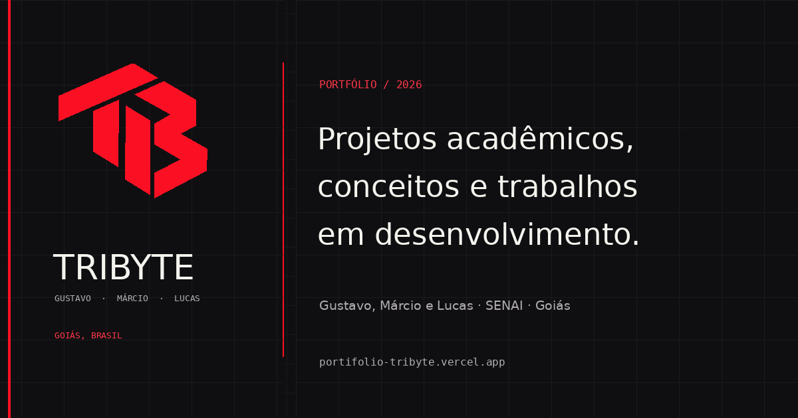

  

# TRIBYTE

Somos Gustavo, Márcio e Lucas, estudantes de Desenvolvimento de Sistemas no SENAI. Aqui apresentamos nossos projetos, o que estamos desenvolvendo e os tipos de trabalho que podemos construir com você.

[Conhecer o portfólio](https://portifolio-tribyte.vercel.app/) · [Explorar os projetos](#projetos)

## Projetos

| Projeto | O que é | Estágio |
| --- | --- | --- |
| [SENAI Smart Class](https://senai-smart-class-one.vercel.app/) | Painel para acompanhar sensores e controlar equipamentos de uma sala. | Projeto acadêmico desenvolvido em equipe, com demonstração disponível. |
| **Painel comercial** | Proposta visual para acompanhar vendas e metas. | Conceito de interface com dados fictícios. |
| **Vio Finanças** | Projeto pessoal de Márcio Andrey para organização financeira. | Em desenvolvimento, ainda sem demonstração pública. |
| **Portfólio TRIBYTE** | Nosso site de apresentação, com trabalhos, perfis e contato. | Projeto da equipe. |

No Smart Class, as leituras são simuladas quando o hardware não está conectado. Cada trabalho é apresentado no portfólio com seu contexto e estágio de desenvolvimento.

## O que podemos criar

- **Sites institucionais e portfólios:** para apresentar um negócio, seus serviços ou seus trabalhos.
- **Sistemas web:** painéis, cadastros e áreas de gestão para organizar informações e tarefas.
- **Landing pages:** páginas voltadas a um produto, serviço ou campanha.

[Conheça os tipos de projeto no site](https://portifolio-tribyte.vercel.app/#servicos).

## Nossa equipe

- [Gustavo de Brito Vieira](https://github.com/GustavobritoTDS)
- Márcio Andrey
- [Lucas Duarte Costa](https://github.com/lucasduartecosta09)

No portfólio, você encontra a apresentação e os interesses de cada integrante.

## Conte sua ideia

Conte o que você precisa apresentar ou organizar. Pelo site, você pode chamar a equipe no WhatsApp ou preparar uma mensagem com os detalhes do projeto para revisar antes de enviar.

[Conversar sobre um projeto](https://portifolio-tribyte.vercel.app/#contato)
