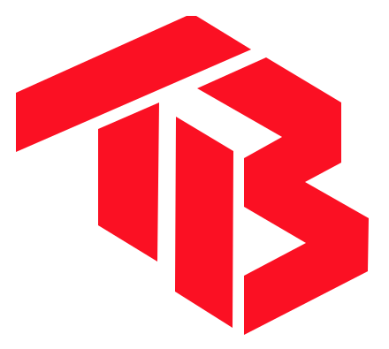

<p align="center">
  
</p>

# TRIBYTE

Portfólio da equipe TRIBYTE: projetos acadêmicos, conceitos de interface e trabalhos em desenvolvimento, reunidos em um site feito com HTML, CSS e JavaScript.

[Ver portfólio](https://portifolio-tribyte.vercel.app/) · [Demo do Smart Class](https://senai-smart-class-one.vercel.app/) · [Projetos apresentados](#projetos-apresentados) · [Executar localmente](#executar-localmente)


## Sobre o projeto

Somos três estudantes de Desenvolvimento de Sistemas no SENAI. Criamos este site para apresentar nossos trabalhos, mostrar quem participa da equipe e facilitar a conversa sobre sites, sistemas e landing pages.

A implementação usa recursos nativos do navegador. O portfólio funciona como um site estático, sem framework, servidor de aplicação ou etapa de build.

## O que você encontra

- **Projetos com contexto:** quatro trabalhos, filtros por categoria e detalhes sobre a origem e o estágio de cada um.
- **Equipe e perfis:** fotografias e biografias abertas em diálogos, com navegação por teclado.
- **Serviços:** seletor de tipo de projeto e painéis com informações sobre sites, sistemas e landing pages.
- **Contato com revisão:** formulário que prepara um briefing local para copiar, baixar ou abrir no WhatsApp. O visitante confirma o envio no aplicativo.
- **Interface responsiva:** temas claro e escuro, abertura animada TRI + BYTE e efeitos de rolagem. A abertura é omitida quando há preferência por movimento reduzido.

## Projetos apresentados

| Projeto | Estágio | O que apresentamos |
| --- | --- | --- |
| **SENAI Smart Class** | Acadêmico, desenvolvido em equipe | Painel de sensores e controles de sala. As imagens mostram o painel; sem o Arduino conectado, as leituras são simuladas. |
| **Painel comercial** | Conceito de interface | Composição visual para acompanhamento de vendas e metas, com valores fictícios. |
| **Vio Finanças** | Projeto pessoal de Márcio Andrey, em desenvolvimento | Proposta de organização financeira, ainda sem demonstração pública. |
| **Portfólio TRIBYTE** | Site da equipe | Este projeto: apresentação dos trabalhos, identidade da marca, perfis e contato. |

O [repositório do Smart Class](https://github.com/GustavobritoTDS/Painel-De-Controle-SALA) reúne a documentação desse sistema. O hardware pertence a esse trabalho; ele não é necessário para executar o portfólio.

As referências a Metabase e Grafana são ilustrações locais com dados fictícios, acompanhadas de links para os produtos originais.

## Executar localmente

Tenha **Git**, **Python 3** e um navegador disponíveis.

```bash
git clone https://github.com/lucasduartecosta09/PORTIFOLIO-TRIBYTE.git
cd PORTIFOLIO-TRIBYTE
python -m http.server 8000 --bind 127.0.0.1
```

Abra [http://127.0.0.1:8000](http://127.0.0.1:8000). Para encerrar o servidor, pressione `Ctrl+C` no terminal.

O portfólio não exige `npm install`, banco de dados, arquivo `.env` ou chave de API. A extensão Live Server do VS Code também pode servir os arquivos.

> [!NOTE]
> O servidor Python oferece a prévia do site, mas não aplica os cabeçalhos definidos em `vercel.json`.

## Organização do código

| Arquivo ou pasta | Responsabilidade |
| --- | --- |
| `index.html` | Conteúdo, navegação, cartões de projetos, formulário, diálogos e metadados. |
| `styles.css` | Layout, tipografia, temas, responsividade e animações. |
| `site-init.js` | Tema salvo antes da primeira pintura e ativação da abertura. |
| `script.js` | Aplicação em cinco seções comentadas: abertura, interface, efeitos, serviços e referências. |
| `assets/` | Fotografias, imagens dos projetos, marca, fontes, GSAP local, CSS da abertura e licenças de terceiros. |
| `vercel.json` | Cabeçalhos da hospedagem, política de segurança de conteúdo e cache de recursos. |
| `robots.txt` e `sitemap.xml` | Informações para descoberta e indexação da página. |

O JavaScript próprio está em dois arquivos. A biblioteca GSAP permanece separada em `assets/` e é solicitada quando a abertura é ativada.

### Onde alterar o conteúdo

- **Trabalhos e contato:** `PROJECTS` e `CONTACT`, na seção 02 de `script.js`. Manter os dados dos projetos e os cartões de `index.html` sincronizados.
- **Tipos de serviço:** seção 04 de `script.js` e conteúdo correspondente em `index.html`.
- **Referências ilustrativas:** seção 05 de `script.js`.
- **Textos, fotos e links da equipe:** `index.html` e arquivos usados em `assets/`.

## Equipe

- [Gustavo de Brito Vieira](https://github.com/GustavobritoTDS)
- Márcio Andrey
- [Lucas Duarte Costa](https://github.com/lucasduartecosta09)
